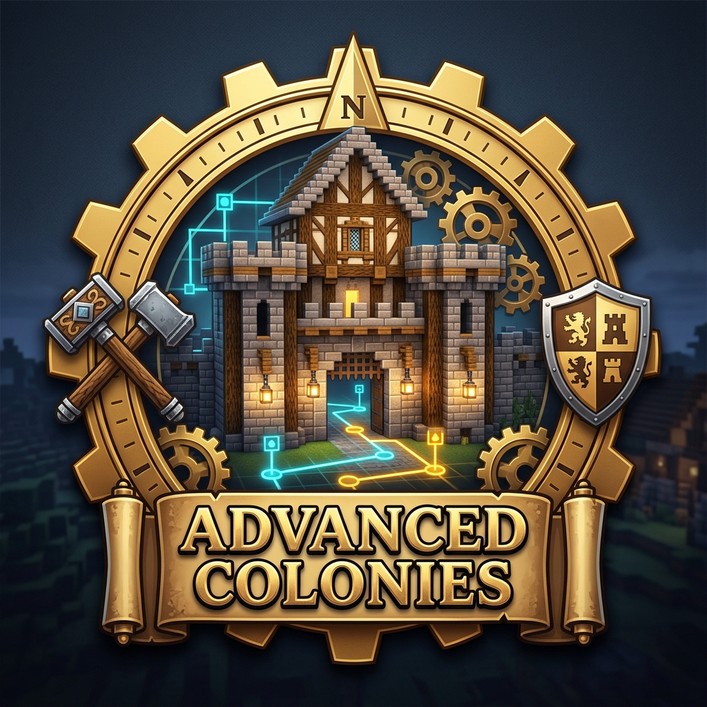

<p align="center">
  
</p>

# Advanced Colonies

[](https://www.minecraft.net/)
[](https://neoforged.net/)
[](https://www.curseforge.com/minecraft/mc-mods/minecolonies)
[](https://adoptium.net/)
[](LICENSE)

**Advanced Colonies** is a comprehensive AI, pathfinding, logistics, worker optimization, and immersion overhaul for **MineColonies** on **Minecraft 1.21.1 (NeoForge)**.

Built from the ground up with clean, non-destructive Mixin hooks (`@Inject` / `@Redirect` only—zero `@Overwrite` conflicts) and strict **server-enforced configuration limits**, Advanced Colonies resolves long-standing AI bottlenecks in both vanilla MineColonies and *Colony Pathing Edition* while introducing a live **3D Visual AI Debugger**, **Tactical Guard Patrol Dispersion**, and a **Context-Reactive Citizen Voiceline & Emotional Audio System**.

---

## ✨ Key Features

### 1. 🧭 Next-Gen Pathfinding & Self-Healing Navigation
* **Manhattan Tie-Breaker Heuristic & Zero-Allocation Node Evaluation**: Eliminates A* grid oscillation and reduces pathfinding thread allocations under heavy colony load.
* **Colony Footpath & Road Speed Bonus**: Citizens actively prefer established colony roads and footpaths and receive a configurable movement speed boost on path blocks.
* **Safe Vertical Traversal (Rails, Ladders, Vines & Scaffolding)**: Fixes fall-damage and mid-air dismount bugs when citizens climb or descend vertical rails, vines, and scaffolding.
* **Chunk-Load Safety & Anti-Stuck Recovery**: Prevents citizens from pathing into unloaded chunks and upgrades `PathingStuckHandler` to smoothly nudge, re-path, or safely unstuck trapped workers without teleporting them into solid blocks or hazards.
* **Immediate Job Cancellation on Re-Pathing**: Cancels stale asynchronous path jobs whenever a citizen switches targets, eliminating "ghost path" rubberbanding.

---

### 2. 🗣️ Context-Reactive Voicelines, Emotional Audio & 3D Speech Bubbles
Vanilla MineColonies and *TownTalk* trigger random sound events that frequently contradict what a citizen is actually doing (e.g., complaining about rain while indoors, playing full-stomach sounds during combat, or spamming low-housing complaints while working across town due to a vanilla `if/else` fall-through bug).

* **Real-Time Situational Priority Engine**: Evaluates 21 live contexts before any citizen speaks:
  * **Guard Combat vs. Civilian Raid Panic**: Guards shout battle cries while civilians call for help and seek shelter.
  * **Tactical Guard Retreat**: Wounded guards call out when falling back to recover.
  * **Illness & Hospital Visits**: Feverish, congested voice lines when sick.
  * **Graveyard Mourning**: Somber remembrance lines when mourning a fallen colonist.
  * **True Outdoor Weather Exposure**: Citizens only react to rain or thunderstorms when actually standing under an open sky (`canSeeSky`).
  * **Dining, Hunger & Missing Equipment**: Triggered only when genuinely starving, actively dining at a Restaurant, or waiting on missing tools/materials.
  * **Proximity-Checked Housing Comfort**: Citizens only comment on cramped or luxurious residences when actually near their home.
  * **Guard-to-Worker & Neighbor Social Chatter**: Patrolling guards reassure nearby workers, workers thank passing guards by name (`{guard}`), and neighbors greet each other (`{friend}`) or the player (`{player}`).
* **380+ Natural English Voicelines Across 28 Professions**: Tailor-made lines for *Builders, Farmers, Planters, Miners, Quarriers, Lumberjacks, Couriers, Cooks, Bakers, Healers, Researchers, Teachers, Enchanters, Concrete Mixers, Blacksmiths, Smelters, Carpenters, Stonemasons, Cowboys, Shepherds, Beekeepers, Herders, Fishermen, Alchemists, Florists, Artisans, Undertakers,* and *Knights/Rangers/Druids*.
* **376 Built-In Emotional `.ogg` Voice Clips (Gemini 3.8 Live)**:
  * Includes 376 mono 24 kHz Ogg Vorbis audio files across all **8 citizen voice profiles** (`male1`–`male4`, `female1`–`female4`) synthesized with **Google Gemini 3.8 Live** emotional voice acting.
  * Automatically expands **10,150 citizen sound event mappings** (`assets/minecolonies/sounds.json`), blending seamlessly with *TownTalk* or standalone MineColonies.
* **Floating 3D Speech Bubbles**: Displays word-wrapped, color-coded 3D speech bubbles (`[Name • Job]`) above speaking citizens, automatically stacking above the `/acdebug` overlay when active.

---

### 3. 🛡️ Tactical Guard Patrol Dispersion & Dynamic Swarm Defense
* **Peacetime Patrol Dispersion (Anti-Clumping)**: Prevents guards from clumping into a single "deathball" during routine patrols. Guards dynamically score and select buildings/waypoints with the fewest nearby guards and recent visits, maximizing **colony security coverage** and **citizen happiness bonuses**.
* **Automated Combat Swarm Mode**: The moment a colony raid begins or a large hostile mob pack (`guardSwarmThreatThreshold`, default `3+` hostiles) is detected, guards automatically override dispersion and converge on the threat as a coordinated tactical unit.
* **Raider Threat Rebalancing & Fleeing Guard Protection**: Prioritizes active combatants over retreating, critically wounded guards so fleeing guards have a fair chance to recover.

---

### 4. 🔍 In-Game 3D Visual AI, Stats & Pathfinding Debugger (`/acdebug`)
Diagnose AI states, bottlenecks, and pathfinding issues in real time without reading log files:
* **Floating Multi-Line Citizen HUD Billboards**: Displays `[#ID] Name (Job)`, live Citizen & Worker AI state transitions (`AI: WORK -> BUILD_SOLID`), vitals (`HP | Sat | Hap`), and pathfinding progress or stuck timers (`STUCK [Lv.2 | 8.5s]`).
* **3D World-Space Path Rendering**: Draws color-coded 3D node boxes and route lines in the world:
  * 🟢 **Green**: Upcoming ground path nodes
  * 🟡 **Yellow**: Active target waypoint
  * 🔵 **Blue**: Reached path nodes
  * 🩵 **Cyan**: Ladder / climb nodes
  * 🟠 **Orange**: Rail traversal nodes
  * 🔴 **Red**: Stuck state & direct line-of-sight vector to the unreachable target block

---

### 5. ⚒️ Worker AI, Crafting & Building Enhancements (Server-Limited)
Every worker enhancement respects strict server-side caps to protect TPS and multiplayer balance:
* **Builder & Structure AI**:
  * Configurable instant block breaking (`builderInstantBreak`), Fluidlogged block cleanup, and batch scavenging/building (`builderMaxBuildBatchSize`) without skipping blueprint stages.
  * Optional structure build order reversal (top-down / bottom-up) and relaxed Builder hut level restrictions for upgrades.
* **Miner & Quarrier**:
  * Instant fluid/lava and air pocket sealing with Cobblestone (`minerInstantFluidFill`) to prevent shaft flooding and stalls.
* **Farmer, Planter & Multi-Season Crop Rotation**:
  * Fixed outward spiral field scanning so outer farmland tiles are never skipped.
  * Fixed `MinecoloniesCropBlock` survival checks and right-click harvest yield scaling (`farmerMaxHarvestMultiplier`).
  * **Multi-Season FarmField Crop Rotation**: Configure multiple seasonal seeds and custom season durations per field (clamped by `cropRotationMaxSeasons` and `cropRotationMaxSeasonDays`).
* **Lumberjack**:
  * Downward stump-finding fix for floating **Mangrove Propagules** (`TreeMangroveStumpMixin`) and configurable felling speed.
* **Deliveryman & Warehouse Logistics**:
  * Street-grouped batch deliveries & pickups (`deliveryBatchMaxSize`) and multi-warehouse courier assignment support.
* **Smelter, Cook, Kitchen & Restaurant**:
  * Accelerated furnace smelting and fuel efficiency scaling with worker skill and building level (`furnaceMaxSpeedMultiplier`).
  * Instant citizen dining (`instantEat`) and smarter restaurant stocking.
* **Enchanter**:
  * Batch Ancient Tome / Book requests (`enchanterBookRequestBatchSize`), building-level mana caps (`enchanterMaxLevelPerBuildingLevel`), and autonomous daily XP drain from designated colony workers.
* **Concrete Mixer**:
  * Batch concrete powder placement and cured block harvesting clamped to `concreteMixerMaxBatchSize`.
* **Cowboy, Beekeeper & Herders**:
  * Multi-milking and mushroom stew collection per visit (`cowboyMaxMilkPerVisit`), removal of the `ItemLargeBottle` cooldown, Beekeeper hive-harvest priority when shearing is disabled, and automatic bee penning near hives.

---

### 6. 🏛️ Colony Quality of Life & GUI Improvements
* **Multi-Keyword & JEC GUI Item Search**: Space-separated multi-keyword filtering across all MineColonies item selection windows, with optional *Just Enough Characters (JEC)* phonetic search support.
* **Tavern Coin Recruitment**: Recruit visitors using gold/silver/copper coins (`recruitmentCostMultiplier`) alongside standard recruitment items.
* **Remote Hospital Cure & Graveyard Controls**: Optional remote healing when Healers have required cures, configurable grave decay timers, and mourning duration controls.
* **Farmland Trampling Protection**: Skill-aware and configurable protection against citizens/raiders trampling colony farmland.
* **Colony Beacon Range Extension**: Extends Beacon status effects across the entire colony boundary.

---

## 💬 Commands

All visual debugger commands are available under `/acdebug` (configurable permission level via `visualDebugCommandPermissionLevel`, default `0` so colony owners/officers can debug their own colonies):

| Command | Description |
| :--- | :--- |
| `/acdebug colony [colonyId]` | Toggles the 3D visual debugger for all citizens in your current (or specified) colony. |
| `/acdebug citizen <citizenId> [colonyId]` | Toggles the 3D visual debugger for a specific citizen ID. |
| `/acdebug look` | Toggles the 3D visual debugger for the citizen you are currently looking at (up to 32 blocks). |
| `/acdebug filter <actions\|stats\|pathfinding> <true\|false>` | Shows or hides specific layers (AI states, vitals/stats, or 3D pathfinding routes). |
| `/acdebug off` | Disables all active debug overlays and clears the client cache. |

---

## ⚙️ Configuration (`advancedcolonies-common.toml`)

All features are modularly organized inside `config/advancedcolonies-common.toml` and enforce hard server limits:

| Config Section | Key Settings & Server Caps |
| :--- | :--- |
| **`[pathfinding]`** | `enableRoadSpeedBonus`, `roadSpeedMultiplier`, `enableVerticalRailNavigation`, `enableSafeChunkGuard`, `enableEnhancedStuckRecovery`, `cancelStalePathJobs` |
| **`[citizens]`** | `enableInstantEating`, `enableRemoteHospitalCure`, `enableMourningControl`, `enableTavernCoinRecruitment`, `enableGuardPatrolDispersion`, `guardPatrolMinSpreadDistance`, `guardSwarmThreatThreshold`, `enableRaiderThreatRebalance`, `protectFleeingGuards` |
| **`[citizens.debug]`** | `enableVisualDebugger`, `visualDebugCommandPermissionLevel`, `visualDebugSyncIntervalTicks`, `visualDebugMaxPathNodes` |
| **`[citizens.voicelines]`** | `enableContextReactiveVoicelines`, `enableSmartSoundEventRouting`, `enableFloatingSpeechBubbles`, `voicelineMinCitizenCooldownSeconds`, `voicelineMinAreaCooldownTicks`, `voicelineMaxRangeBlocks`, `speechBubbleDurationSeconds`, `customVoicelineTemplates` |
| **`[building_capacity]`** | Citizen, worker, and storage capacity multipliers per building level |
| **`[logistics]`** | `enableDeliveryBatching`, `deliveryBatchMaxSize`, `enableMultiWarehouseCouriers`, `minimumStockMaxMultiplier` |
| **`[furnace_and_craft]`** | `furnaceMaxSpeedMultiplier`, `craftingBatchMaxSize`, `enchanterBookRequestBatchSize`, `enchanterMaxLevelPerBuildingLevel`, `enableEnchanterAutonomousDrain` |
| **`[builder_and_excavation]`** | `builderMaxBuildBatchSize`, `builderInstantBreak`, `minerInstantFluidFill`, `concreteMixerMaxBatchSize` |
| **`[agriculture_and_herding]`** | `enableFarmlandTrampleProtection`, `farmerMaxHarvestMultiplier`, `enableMultiSeasonCropRotation`, `cropRotationMaxSeasons`, `cropRotationMaxSeasonDays`, `cowboyMaxMilkPerVisit`, `enableBeekeeperHivePriority`, `enableBeekeeperBeePenning`, `enableMangroveStumpFix` |

### Custom Voiceline Templates
Server administrators and modpack creators can add custom situational or job-specific voicelines in `advancedcolonies-common.toml` under `customVoicelineTemplates`:
```toml
customVoicelineTemplates = [
    "PLAYER_GREETING:Welcome back to {colony}, {player}! The {building} is running at full speed.",
    "ACTIVE_JOB_WORK|builder|Raising another wall for {colony} at our level {building_level} {building}!",
    "WORKER_THANKS_GUARD|*|Always glad to have {guard} patrolling past the {building}!"
]
```
**Supported Placeholders:** `{citizen}`, `{job}`, `{building}`, `{building_level}`, `{colony}`, `{player}`, `{guard}`, `{friend}`, `{weather}`, `{time}`.

---

## 📦 Installation

1. Install **Minecraft 1.21.1** with **NeoForge `21.1.200`** or newer.
2. Install **MineColonies** (`1.1.1285-1.21.1` or newer) and its required dependencies (*Structurize*, *BlockUI*, *Multi-Piston*, *Domum Ornamentum*).
3. Drop `advancedcolonies-1.21.1-0.1.0.jar` into your `mods/` folder (required on both **Client** and **Server** for 3D debug overlays, custom GUI search, and floating speech bubbles).
4. *(Optional)* Fully compatible with **TownTalk**—Advanced Colonies smartly routes *TownTalk* sound events to match live citizen contexts and expands the voice pool with 376 additional emotional voice clips.

---

## 🛠️ Building from Source

### Prerequisites
* **JDK 21** (Eclipse Temurin / Adoptium recommended)

### Build Steps
```powershell
git clone https://github.com/GeneraBlack/AdvancedColonies.git
cd AdvancedColonies
.\gradlew.bat build
```
The compiled mod JAR will be located in `build/libs/advancedcolonies-1.21.1-0.1.0.jar`.

---

## 📄 License

This project is licensed under the **MIT License**.
